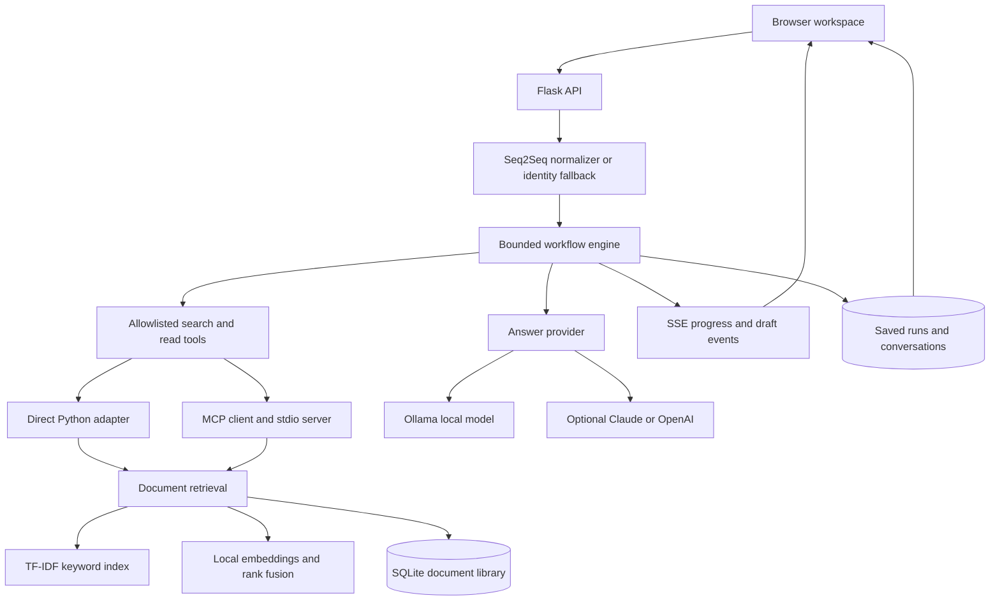

# Workflow Lab — MCP Agentic Workflows + Seq2Seq NLP

A local document research workspace built with **Python, Flask, PyTorch, MCP, Ollama, OpenAI, and Anthropic Claude**. Upload documents, ask questions, compare two sources, and inspect the evidence behind an answer.

The project combines a trainable query normalizer, hybrid retrieval, bounded agent orchestration, and a browser interface with streamed answers and PDF citations. It runs without cloud API keys; cloud providers are optional.

## Contents

- [Features](#features)
- [Architecture](#architecture)
- [Quick start](#quick-start)
- [Local AI and semantic search](#local-ai-and-semantic-search)
- [OpenAI and Claude](#openai-and-claude)
- [Using the workspace](#using-the-workspace)
- [Document ingestion and OCR](#document-ingestion-and-ocr)
- [MCP tools](#mcp-tools)
- [Seq2Seq training](#seq2seq-training)
- [Evaluation and benchmarks](#evaluation-and-benchmarks)
- [API reference](#api-reference)
- [Configuration](#configuration)
- [Testing](#testing)
- [Project structure](#project-structure)
- [Privacy and limitations](#privacy-and-limitations)
- [Troubleshooting](#troubleshooting)

## Features

| Capability | Behavior |
| --- | --- |
| Document knowledge base | Import PDF, DOCX, TXT, Markdown, or pasted text into a persistent SQLite library. |
| Grounded explanations | Generate answers from retrieved passages using local AI, Claude, or OpenAI. |
| Hybrid retrieval | Combine TF-IDF keyword search and local dense embeddings using reciprocal rank fusion. |
| Document comparison | Balance evidence from two selected documents and cite both. |
| PDF source inspection | Open the original PDF at the cited page, with extracted-text and available page-text highlights. |
| Research conversations | Retain bounded follow-up context within a document scope. |
| Streaming and cancellation | Show draft text and execution steps; stop active generation without saving the draft as a completed answer. |
| Missing-evidence handling | Return an insufficient-evidence response when the model reports that the sources do not answer the question. |
| Scanned-PDF OCR | Recognize English text locally with Tesseract and PDFium. |
| MCP integration | Switch between direct Python tools and a real MCP stdio client/server boundary. |
| Trainable NLP pipeline | Train a small PyTorch GRU encoder-decoder for query normalization. |
| Evaluation dashboard | Compare retrieval variants on bundled or custom relevance-labeled questions. |
| Human review | Rate answer helpfulness and whether its claims are supported by sources. |
| Workflow history | Persist runs and traces; show five recent workflows with pagination and JSON export. |
| In-app provider setup | Configure and test optional cloud credentials in server memory for the current session. |

## Architecture



### How a question becomes an answer

1. Validate the question, provider, selected documents, and conversation scope.
2. Normalize the question with the trained Seq2Seq checkpoint when applicable. Missing checkpoints and unknown vocabulary use an explicit identity fallback.
3. Retrieve relevant passages. Normal searches fuse lexical and semantic ranks; paper overviews prioritize opening sections and abstracts. Comparisons interleave evidence from both selected documents.
4. Read the retrieved evidence through the selected local or MCP tool transport.
5. Generate an explanation. Local AI uses a fixed search/read/synthesis path. Cloud providers use a bounded JSON action loop to request tools or produce a final answer.
6. Stream draft answer fields and workflow steps to the browser. Drafts are explicitly unvalidated.
7. Check citation identifiers and required response fields, then persist the final result and execution trace.

Citation checks establish that cited passages exist. They do **not** prove that every generated claim follows from those passages.

### Reliability model

Cloud orchestration permits up to six action turns. Transient connection errors, timeouts, rate limits, and selected server errors receive bounded retries with exponential backoff. Cloud workflows have a 90-second overall deadline; local synthesis allows 180 seconds within a 210-second workflow deadline.

Streaming jobs are in-process, with at most two active jobs. Cancellation interrupts the task and records a cancelled run. Jobs do not survive a server restart, and interrupted work does not automatically resume. This is not a durable distributed workflow system.

## Quick start

### Requirements

- Python **3.11 or newer**; Python 3.12 was used for local development.
- A CPU-supported PyTorch installation.
- Optional: Ollama for local answer generation and semantic retrieval.
- Optional: Tesseract with English language data for scanned PDFs.

```bash
git clone https://github.com/dheeraj2804/mcp-seq2seq-workflows.git
cd mcp-seq2seq-workflows
python3 -m venv .venv
source .venv/bin/activate
python -m pip install -e '.[dev]'
cp .env.example .env
PORT=5001 python -m workflows.app
```

Open **http://127.0.0.1:5001/**. Choose **Local extractive summary** for the first run if Ollama is not installed. Seven educational documents are bundled, so uploads are optional.

The default port is 5000 when `PORT` is unset. The examples here explicitly use 5001. Restart Flask after source changes because debug reload is disabled.

```bash
curl http://127.0.0.1:5001/health
curl -X POST http://127.0.0.1:5001/api/workflows \
  -H 'Content-Type: application/json' \
  -d '{"query":"How does MCP tool integration work?","provider":"demo"}'
```

No checkpoint or API key is required. The demo provider selects source sentences; it does not paraphrase with a generative model.

## Local AI and semantic search

On macOS with Homebrew:

```bash
brew install ollama tesseract
ollama serve
```

In a second terminal:

```bash
ollama pull llama3.2:3b
ollama pull all-minilm:22m
source .venv/bin/activate
./scripts/run-local.sh
```

If Ollama is already running, the script reuses it. Otherwise it starts a loopback-only Ollama server, disables its cloud features, allows two loaded models, and starts Flask on port 5001. The script stops only the Ollama process it started when it exits.

- **`llama3.2:3b`** writes explanations from evidence. The download is approximately 2 GB and runtime memory use is larger.
- **`all-minilm:22m`** embeds queries and passages for semantic search. Its download is approximately 46 MB.
- The **PyTorch Seq2Seq model** is a separate, small query-rewriting model; it is not the model writing answers.

Local generation uses a 4,096-token context and up to 850 generated tokens. Hardware and cold model loading affect latency. The Ollama endpoint must be a loopback HTTP address; cloud model names are rejected.

Embedding vectors are cached in SQLite using a fingerprint of model digest and input text. Inputs to the embedding model are bounded; complete retrieved passages remain available for citations. A default cosine threshold of 0.32 is a heuristic, not a calibrated confidence value. If the embedding service is unavailable, search falls back to keywords and exposes a warning.

## OpenAI and Claude

1. Open **Settings → AI providers**.
2. Select OpenAI or Anthropic Claude and enter an API key.
3. Use **Load models** to discover model IDs available to that key. Choose a suitable text-generation model.
4. Optionally select **Test connection**. This makes a small generation request and can incur API charges.
5. Select **Save for this session**, then choose that provider for a workflow.

Keys entered in the interface stay in server-process memory. They are not written to SQLite, browser storage, exports, or `.env`, and expire when Flask restarts. All tabs connected to the same local server share those settings. Model discovery and connection tests do not send documents.

For environment-based configuration, set the corresponding key **and** model ID in your local `.env`. Never commit that file. Environment values are supported as a fallback; session settings do not rewrite them.

The OpenAI adapter uses the Responses API with `store=False`; Claude uses the Messages API. Selecting **Claude → OpenAI fallback** can send the question and evidence to both providers if the first fails. Explicit single-provider modes do not silently change services.

Cloud streaming adapters have automated mocked coverage. Live cloud generation has not been verified without valid API keys. Provider availability, billing, and data policies are controlled by the selected service.

## Using the workspace

### Ask and inspect

1. Upload a document or use a bundled sample.
2. Select it under **Search within**, especially for questions such as “What is this paper about?”
3. Choose an answer provider and ask a question.
4. Watch the draft and execution progress. Click **Stop workflow** to cancel.
5. Inspect the answer's numbered citations and **View source** controls.
6. Ask a follow-up in the same conversation, or select **New conversation** to reset context.

Conversation context includes a topic anchor and at most two recent answers, truncated to bound input size. Changing document scope starts a new conversation. Cloud providers receive this context along with retrieved evidence.

### Compare documents

Enable **Compare two documents**, select two different library documents, and ask about their similarities or differences. Retrieval balances passages from each. Comparisons require evidence from both selected documents; the model is instructed not to directly rank experimental metrics collected on incompatible datasets or settings.

### Evidence status

The evidence badge distinguishes extracted source text, model-reported support, insufficient evidence, and unverified older outputs. Model-reported support is a judgment, not a probability or independent fact check. A small local model may refuse an answerable question or make unsupported claims despite citations. Source inspection and human review remain necessary.

### History

The latest five runs appear initially. **Show more workflows** loads five more. Runs include the question, status, elapsed time, evidence, and diagnostics; **Export JSON** downloads the current result. Cancelled drafts are not stored as completed answers.

## Document ingestion and OCR

| Input | Support and limits |
| --- | --- |
| PDF | Up to 20 MiB and 500 pages; original bytes retained locally for citation viewing. |
| Scanned PDF | Opt-in English OCR, up to 20 scanned pages per upload. |
| DOCX | Body paragraphs and table text; older `.doc` files must be converted first. |
| TXT / Markdown | UTF-8 or BOM-marked UTF-16 text. |
| Pasted or extracted text | 20–2,000,000 characters per document. |

These are per-document limits, not a total-library size limit. Library capacity depends on available disk and RAM. The multipart request bound is 21 MiB. DOCX archives may expand to at most 50 MiB.

PDF extraction uses pypdf. Wrapped lines and Unicode are normalized, and passages are grouped at paragraph or sentence boundaries, generally around 1,500 characters. PDF page boundaries remain available for citations. Complex layouts, equations, and tables can still produce extraction artifacts.

Enable **Recognize scanned pages with local OCR** when importing a scanned file. PDFium renders pages without sufficient selectable text, and Tesseract recognizes English text. OCR may misread words, numbers, or equations. Recognition confidence measures text recognition, not factual correctness. Already imported scanned files need to be uploaded again with OCR enabled.

Parsing runs in a separate process: normally a 60-second wall-clock / 45-second CPU limit; OCR increases these to 180 / 120 seconds where CPU limits are supported. File size limits are not hard parser memory limits. Encrypted PDFs must be unlocked before importing.

DOCX images, headers, footnotes, and layout are omitted. Non-PDF formats retain extracted text and metadata rather than the original file. Original PDFs render locally through bundled PDF.js; they are not sent to a hosted PDF viewer.

```bash
curl -X POST http://127.0.0.1:5001/api/documents \
  -F 'file=@/absolute/path/report.pdf' \
  -F 'title=Research report' \
  -F 'ocr=true'
```

## MCP tools

Set `TOOL_TRANSPORT=mcp` in `.env` and restart Flask to use the bundled MCP subprocess instead of direct Python tool calls.

```bash
python -m workflows.mcp_server
```

The server exposes allowlisted document search and read tools. Both transports use the same library and enforce document scope. There is no arbitrary shell execution or general filesystem tool available to the research agent. The MCP subprocess is not given provider API keys.

The project targets MCP Python SDK 1.x and bounds the dependency below 2.0. Tests exercise a real stdio MCP client/server exchange, in addition to local tool calls.

## Seq2Seq training

```bash
python -m scripts.train --epochs 120
```

The model is a GRU encoder-decoder trained with teacher forcing, cross-entropy loss, gradient clipping, and a fixed seed. Greedy decoding generates a compact keyword sequence. Training writes:

- `artifacts/seq2seq.pt`
- `artifacts/training_metrics.json`

Restart Flask after training to load the checkpoint. Without it, or when a query contains unknown vocabulary, the normalizer returns the original query with `mode: identity`.

Training data consists of synthetic templates over seven educational intents, with a held-out template split. This demonstrates the training/inference pipeline; it does not establish broad language understanding or generalization to research papers. A stronger model needs licensed real data and splits by document or semantic intent.

## Evaluation and benchmarks

### Retrieval dashboard

Open **Evaluation** to compare:

1. Keyword retrieval.
2. Hybrid semantic + keyword retrieval.
3. Hybrid retrieval after Seq2Seq query normalization.

The bundled set contains 50 authored questions for the seven educational documents, including eight negative queries. Evaluations search the current library, so review labels when imported documents change what is relevant.

| Metric | Meaning |
| --- | --- |
| Document recall @3 | Relevant labeled documents found within the first three results. |
| Mean reciprocal rank | How early the first relevant document appears; 1.0 means first place. |
| No-hit accuracy | Empty retrieval on questions labeled as having no relevant document. |
| Median / P95 latency | Retrieval timing for the evaluated questions, including embedding requests in hybrid modes. |

Timings use a warm document index and exclude answer generation, app HTTP, and MCP overhead. Small sets, caching, and execution order influence timing. One question cannot establish a reliable latency distribution or a general accuracy claim. No-hit accuracy does not measure full answer abstention.

To create a custom set, expand **Create an evaluation set for your documents**, name it, add questions and relevant document labels, then save and run it. Sets support up to 100 questions. Reports and labels persist locally and can be exported.

Automatic evaluation measures retrieval, not generated-answer faithfulness. **Rate this answer** records subjective helpfulness and source-support reviews separately.

### Indexed-retrieval benchmark

```bash
python -m scripts.benchmark --copies 500 --rounds 20
```

This compares scan and inverted-index retrieval using the same ranking formula on a synthetic repeated corpus, checks ranking equivalence for unchanged queries, and separately times normalization plus indexed retrieval. It writes `artifacts/benchmark.json`.

Index construction, HTTP, MCP startup, and generation are excluded. Rewriting can change rankings. This benchmark does **not** establish a 30% production retrieval improvement. Report the corpus, hardware, quality metrics, and timing scope whenever discussing performance.

## API reference

All examples assume `http://127.0.0.1:5001`.

| Method | Route | Purpose |
| --- | --- | --- |
| GET | `/health` | Model, OCR, provider configuration, and transport status. |
| POST | `/api/normalize` | Normalize a `query`. |
| POST | `/api/workflows` | Run synchronously and persist the result. |
| GET | `/api/workflows` | Paginated run summaries; `limit` 1–50 and optional `before` cursor. |
| GET | `/api/workflows/<id>` | Retrieve a saved run. |
| POST | `/api/workflow-jobs` | Start an asynchronous streaming job. |
| GET | `/api/workflow-jobs/<id>/events` | SSE progress, draft, result, error, and completion events. |
| DELETE | `/api/workflow-jobs/<id>` | Cancel an active job. |
| GET / POST | `/api/documents` | List documents or import text/files. |
| GET | `/api/documents/<id>/pdf` | Read a retained original PDF. |
| POST | `/api/documents/<id>/original` | Attach an original PDF after matching indexed text. |
| GET | `/api/workflows/<id>/sources/<index>` | Inspect a cited passage and page/highlight information; index starts at 1. |
| GET | `/api/conversations/<id>` | Read the latest 20 stored conversation turns. |
| GET / POST | `/api/evaluation-sets` | List or create evaluation datasets. |
| GET | `/api/evaluation-sets/<id>` | Read an evaluation set. |
| GET / POST | `/api/evaluations` | Read the latest report/review summary or run a dataset evaluation. |
| POST | `/api/workflows/<id>/feedback` | Save or revise human answer feedback. |
| GET | `/api/settings/providers` | Read configuration status without retrieving keys. |
| POST / DELETE | `/api/settings/providers/<provider>` | Save session configuration or disconnect. |
| POST | `/api/settings/providers/<provider>/models` | Discover models with draft or saved credentials. |
| POST | `/api/settings/providers/<provider>/test` | Test provider connectivity. |

Workflow request fields:

```json
{
  "query": "What is the main contribution of this paper?",
  "provider": "local",
  "document_id": "document-id-from-library"
}
```

Providers: `demo`, `local`, `claude`, `openai`, and `auto`. Queries must contain 1–1,000 characters. Pass `conversation_id` for a follow-up. For comparison, use `document_ids: ["first-id", "second-id"]` instead of a single `document_id`.

Start streaming by posting the same body to `/api/workflow-jobs`, then subscribe to the returned job's events route with `EventSource`. Draft events are cumulative previews, not final validated answers. Cancel with `DELETE`. Jobs are ephemeral and cannot resume after a process restart.

Evaluation requests accept `dataset_id` (`builtin` or a saved custom set ID). Provider-settings mutations require the page's `X-Settings-Token` and same-origin checks; use the app interface for credential configuration.

## Configuration

Copy `.env.example` to `.env`; values are loaded at startup.

| Variable | Default / purpose |
| --- | --- |
| `PORT` | 5000 when unset; use 5001 in the examples or local startup script. |
| `TOOL_TRANSPORT` | `local`; set `mcp` for stdio tools. |
| `OLLAMA_BASE_URL` | `http://127.0.0.1:11434`; loopback HTTP only. |
| `OLLAMA_MODEL` | `llama3.2:3b`. |
| `EMBEDDING_MODEL` | `all-minilm:22m`. |
| `SEMANTIC_SEARCH` | `on`; set `off` for keyword-only search. |
| `SEMANTIC_MIN_SIMILARITY` | `0.32`; semantic candidate threshold. |
| `OPENAI_API_KEY` | Optional OpenAI credential. |
| `OPENAI_MODEL` | Explicit model ID available to the key. |
| `ANTHROPIC_API_KEY` | Optional Claude credential. |
| `ANTHROPIC_MODEL` | Explicit model ID available to the key. |

Cloud model IDs are deliberately not guessed or hardcoded in the example configuration.

## Testing

```bash
source .venv/bin/activate
SEMANTIC_SEARCH=off python -m pytest -q
```

The suite contains **50 tests** at this revision, covering request validation, persistence, retry/fallback behavior, real MCP stdio communication, document ingestion, citations, conversations, provider settings, balanced comparisons, semantic cache behavior, streamed drafts, cancellation, missing evidence, and custom evaluation sets. Semantic unit tests inject deterministic embeddings; the environment setting prevents unrelated tests from relying on a running model service.

The image-only PDF OCR test uses real PDFium and Tesseract when available and skips if native OCR support is missing. Cloud streaming tests mock SDK responses and require no paid calls. Local smoke checks separately exercised Ollama generation, real embeddings, evidence refusal, comparison, cancellation, and custom evaluation through the running app.

### Manual smoke test

1. Ask a bundled-document question in extractive mode and inspect its source.
2. With Ollama running, import a research PDF and ask for its main idea.
3. Open a citation and verify the original page supports the explanation.
4. Ask a follow-up, then ask for a fact the paper does not report.
5. Start a longer answer and stop it; confirm the history says Cancelled.
6. Compare two documents and verify both appear in the evidence.
7. Import an image-only PDF with OCR enabled and inspect recognized text.
8. Create a labeled evaluation set, run it, and export the report.

## Project structure

```text
.
├── data/
│   ├── documents.json          # Seven educational sample documents
│   └── evaluation.json         # Built-in relevance labels
├── scripts/
│   ├── train.py                # Synthetic Seq2Seq training
│   ├── benchmark.py            # Scan/index timing and equivalence
│   └── run-local.sh            # Local Ollama + Flask startup
├── tests/                      # API, model, MCP, ingestion, and extension tests
├── workflows/
│   ├── app.py                  # Flask application and provider settings routes
│   ├── engine.py               # Orchestration, retries, deadlines, evidence handling
│   ├── providers.py            # Ollama, Claude, and OpenAI adapters
│   ├── tools.py                # Direct and MCP client tool adapters
│   ├── mcp_server.py           # MCP stdio server
│   ├── nlp.py                  # GRU model and query inference
│   ├── retrieval.py            # TF-IDF index and scan baseline
│   ├── hybrid.py               # Local embeddings, cache, and rank fusion
│   ├── library.py              # Document storage and passage indexing
│   ├── ingestion.py            # Bounded document parsing subprocess
│   ├── ocr.py                  # PDFium rendering and Tesseract OCR
│   ├── research.py             # Citations, conversations, evaluation, feedback
│   ├── jobs.py                 # In-memory jobs and SSE endpoints
│   ├── progress.py             # Progress hooks and structured draft previews
│   ├── settings.py             # Session provider configuration
│   ├── text.py                 # Text cleanup and passage boundaries
│   ├── templates/index.html    # Browser workspace
│   └── static/                 # UI assets and bundled PDF.js
├── artifacts/                  # Generated locally; excluded from Git
├── .env.example                # Placeholder configuration; no credentials
└── pyproject.toml              # Python package and dependency bounds
```

## Privacy and limitations

- The service binds to localhost and rejects non-local hostnames. It has no authentication or per-user data isolation and is not ready for public hosting.
- Local and extractive modes keep document processing on the local machine. Cloud modes send selected evidence, questions, and bounded conversation context to the chosen provider.
- Library documents, PDF originals, embeddings, queries, conversations, feedback, and reports persist locally in SQLite. There is no automatic retention cleanup.
- `.gitignore` excludes local environment files, credentials, virtual environments, databases, checkpoints, logs, and generated artifacts. The repository does not include uploaded papers or local conversation history.
- Retrieved content is treated as untrusted evidence, but prompt instructions and citation checks cannot eliminate prompt injection or hallucination risk.
- OCR and PDF extraction can corrupt mathematical notation and layout. Always inspect the original when precision matters.
- The synthetic Seq2Seq model and educational evaluations demonstrate engineering mechanics, not production model quality. No production speed or accuracy guarantee is claimed.
- Before shared deployment, add authentication, authorization, rate limits, retention controls, durable job execution, and production WSGI hosting. The Flask development server is intended for local development.

## Troubleshooting

| Symptom | What to check |
| --- | --- |
| Local AI needs setup | Start Ollama and pull the configured generation model. |
| Keyword fallback warning | Pull `all-minilm:22m` and confirm `OLLAMA_BASE_URL` and `EMBEDDING_MODEL`. |
| OCR unavailable | Install Tesseract and English data; ensure `tesseract` is on `PATH`, then restart Flask. |
| Uploaded scan has no text | Enable OCR and upload again; check the 20-scanned-page limit. |
| OpenAI / Claude cannot run | Save both a key and an available model ID in Settings; test connectivity. |
| Saved credentials disappeared | UI credentials intentionally expire when Flask restarts. |
| Query normalization says identity | Train the checkpoint and restart; unfamiliar vocabulary still falls back to identity. |
| Port already in use | Stop the existing server or start with another `PORT`. |
| Changes do not appear | Restart Flask and reload the browser; debug reload is off. |
| Evaluation dropdown differs from the table | The table can display the latest saved report; select the intended set and run it again. |
| An overview is refused | Inspect the retrieved passages, select the document explicitly, and try a focused question. Model support labels are imperfect. |

## References and third-party notices

- [MCP Python SDK](https://github.com/modelcontextprotocol/python-sdk)
- [Ollama API documentation](https://docs.ollama.com/api)
- [pypdf extraction documentation](https://pypdf.readthedocs.io/en/stable/user/extract-text.html)
- [PDF.js](https://github.com/mozilla/pdf.js), bundled with its Apache 2.0 license and font notices under `workflows/static/pdfjs/`.

Model downloads have their own licenses and terms. Uploaded documents remain the user's responsibility; no research-paper PDFs or model weights are redistributed in this repository.
